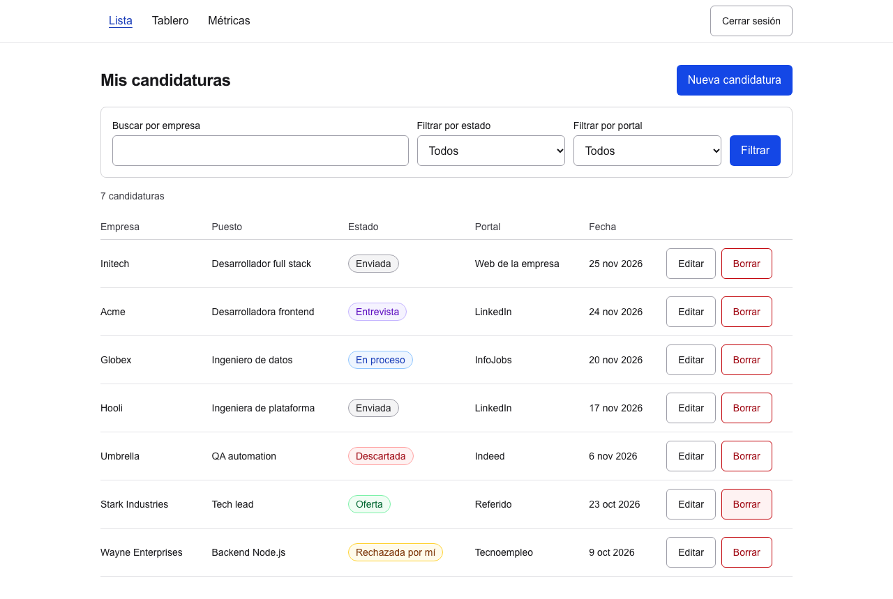
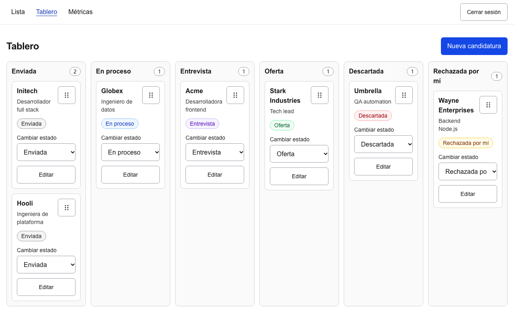
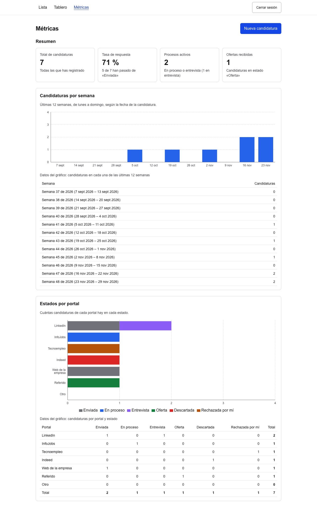
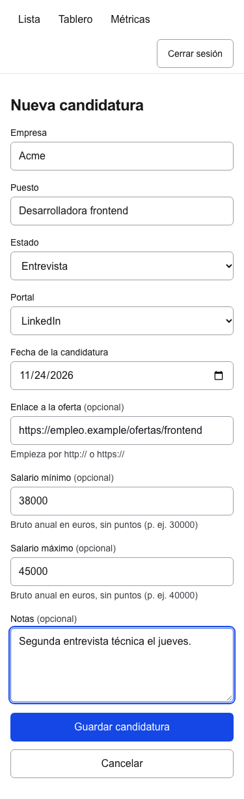
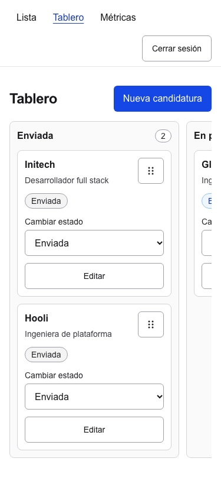
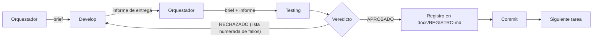

# JobTrack

Gestor de candidaturas de empleo: apunta cada oferta a la que te presentas, sigue su estado en
un tablero kanban y mira cómo va tu búsqueda con unas métricas sencillas. Hecho con Next.js y
Supabase, y construido por un equipo de agentes de IA (orquestador, Develop y Testing) que
trabajan contra unas directrices de calidad verificables.

## Demo

- **URL de producción:**
  [https://jobtrack-brown-two.vercel.app](https://jobtrack-brown-two.vercel.app) (Vercel, con
  Supabase en la nube).
- **Usuario de prueba:** hay un usuario de prueba en producción; sus credenciales se facilitan
  aparte (no están en el repositorio). También puedes crear tu propia cuenta en
  [`/registro`](https://jobtrack-brown-two.vercel.app/registro).
- **Código:** [github.com/juaandix/jobtrack](https://github.com/juaandix/jobtrack) (repositorio
  público).

## Funcionalidades

- **Cuentas de usuario** con Supabase Auth: registro (`/registro`), inicio y cierre de sesión
  (`/login`). Las rutas privadas (`/dashboard/**`) se protegen en el servidor y cada usuario solo
  ve sus datos gracias a Row Level Security (RLS) en Postgres.
- **CRUD de candidaturas**: empresa, puesto, estado, portal, fecha, enlace a la oferta, salario
  mínimo y máximo (bruto anual, €) y notas. La validación usa el mismo esquema Zod en el
  navegador y en el servidor, con errores en español junto a cada campo.
- **Filtros en la URL**: por estado (`status`), por portal (`portal`) y búsqueda por empresa sin
  distinguir tildes ni mayúsculas (`q`). Se pueden compartir y recargar, y los aplica el servidor.
- **Tablero kanban** (`/dashboard/tablero`) con una columna por estado. Las tarjetas se mueven
  arrastrando (dnd-kit) o, sin arrastrar, con el selector de estado de cada tarjeta. El cambio se
  ve al momento y se deshace si el servidor lo rechaza.
- **Métricas** (`/dashboard/metricas`): tarjetas de resumen, candidaturas por semana ISO, tasa de
  respuesta y estados por portal. Cada gráfico tiene su tabla accesible con los mismos datos.
- Diseño mobile-first (usable a 375 px), modo oscuro y estados de carga, vacío y error.

### Capturas

| Lista de candidaturas                                     | Tablero kanban                                       |
| --------------------------------------------------------- | ---------------------------------------------------- |
|  |  |

| Métricas                                        | Formulario (móvil, 375 px)                                  | Tablero (móvil, 375 px)                               |
| ----------------------------------------------- | ----------------------------------------------------------- | ----------------------------------------------------- |
|  |  |  |

Todas las capturas están en [`docs/screenshots/`](docs/screenshots/) (a 1280 px y a 375 px) y se
regeneran con `npm run screenshots`.

## Stack

| Área              | Tecnología (versión en `package.json`)                                                          |
| ----------------- | ----------------------------------------------------------------------------------------------- |
| Framework         | Next.js 16.4 (App Router, `cacheComponents`), React 19.3                                        |
| Lenguaje          | TypeScript 5 en modo estricto                                                                   |
| Estilos           | Tailwind CSS 4.3                                                                                |
| Backend           | Supabase (Auth + Postgres + RLS) con `@supabase/ssr` 0.12 y `@supabase/supabase-js` 2.119       |
| Supabase local    | CLI `supabase` 3.4 (dependencia de desarrollo, se usa con Docker)                               |
| Validación        | Zod 4.6                                                                                         |
| Kanban y gráficos | `@dnd-kit/core` 6.3, Recharts 3.11                                                              |
| Tests             | Vitest 5.1 + Testing Library + jsdom (cobertura con `@vitest/coverage-v8`), Playwright 1.65     |
| Calidad           | ESLint 9 (`eslint-config-next`, `jsx-a11y`) y Prettier 3.10 (con `prettier-plugin-tailwindcss`) |
| Despliegue        | Vercel                                                                                          |

Requiere Node.js 22.12 o superior (`engines` en `package.json`; `.nvmrc` fija la versión 22).

## Estructura de carpetas

```text
.
├── src/
│   ├── app/              # Rutas (App Router): home, (auth)/login, (auth)/registro, dashboard/…
│   ├── components/       # UI: applications, auth, forms, kanban, metrics, navigation, ui
│   ├── lib/              # Lógica pura y acceso a datos (con sus *.test.ts)
│   │   ├── applications/ # Server Actions, repositorio, filtros, agrupación del kanban…
│   │   ├── auth/         # Acciones de sesión, rutas y errores de auth
│   │   ├── metrics/      # Semanas ISO, tasa de respuesta, estados por portal
│   │   ├── validation/   # Esquemas Zod compartidos por cliente y servidor
│   │   ├── supabase/     # Clientes de servidor y navegador (@supabase/ssr)
│   │   └── database.types.ts  # Tipos generados de la base de datos
│   └── proxy.ts          # Refresca la sesión y protege las rutas privadas
├── supabase/
│   ├── config.jsonc      # Configuración del stack local
│   └── migrations/       # Esquema, enums, restricciones y políticas RLS
├── e2e/                  # Playwright: specs locales, smoke de producción (e2e/production/) y capturas (e2e/screenshots/)
├── scripts/              # check-guidelines.sh y test-rls.ts
├── docs/                 # PLAN, DIRECTRICES, REGISTRO y capturas
└── .claude/agents/       # Definiciones de los agentes Develop y Testing
```

## Cómo se construyó: el equipo de agentes

JobTrack se ha desarrollado con tres agentes de IA con papeles separados:

| Rol         | Definición                                               | Qué hace                                                                                                   |
| ----------- | -------------------------------------------------------- | ---------------------------------------------------------------------------------------------------------- |
| Orquestador | [`CLAUDE.md`](CLAUDE.md)                                 | Planifica, escribe un brief por tarea, coordina el ciclo, registra cada ronda y hace commits. No programa. |
| Develop     | [`.claude/agents/develop.md`](.claude/agents/develop.md) | Implementa la tarea (código, migraciones y tests), ejecuta las comprobaciones y entrega un informe.        |
| Testing     | [`.claude/agents/testing.md`](.claude/agents/testing.md) | Revisa cada entrega contra las directrices, ejecuta todos los comandos y emite un veredicto.               |

Documentos que guían el trabajo:

- [`docs/PLAN.md`](docs/PLAN.md): hitos y tareas, la fuente de verdad de qué toca hacer.
- [`docs/DIRECTRICES.md`](docs/DIRECTRICES.md): criterios de calidad con ID (TS, VAL, A11Y, DB,
  SEC, TEST, ARQ, UI) y cómo verificar cada uno. Develop los cumple y Testing los aplica.
- [`docs/REGISTRO.md`](docs/REGISTRO.md): cada ciclo Develop → Testing, con sus rondas y
  decisiones.

Ciclo de cada tarea:



Si una tarea acumula cuatro rondas rechazadas, el orquestador se detiene y consulta al usuario.
Los pasos que necesitan a una persona (crear el proyecto en Supabase, poner claves, conectar
Vercel) son paradas manuales: ningún agente escribe claves reales en ficheros versionados.

## Arranque en local

### Requisitos

- **Node.js 22.12 o superior** y npm. Con nvm: `nvm install` y `nvm use` (leen `.nvmrc`;
  comprueba con `node -v` que la versión es al menos 22.12).
- **Docker** en marcha (Docker Desktop u otro runtime compatible): Supabase local se ejecuta en
  contenedores. La CLI de Supabase no hace falta instalarla aparte; viene como dependencia de
  desarrollo y la usan los scripts `db:*`.

### Pasos

1. Clona el repositorio e instala las dependencias exactas del lockfile:

   ```bash
   git clone https://github.com/juaandix/jobtrack.git jobtrack
   cd jobtrack
   npm ci
   ```

2. Arranca Supabase en local (la primera vez descarga las imágenes de Docker y tarda un rato):

   ```bash
   npm run db:start
   ```

3. Crea tu fichero de variables de entorno a partir de la plantilla:

   ```bash
   cp .env.example .env.local
   ```

4. Rellena `.env.local` con los valores del stack local, que muestra este comando:

   ```bash
   npm run db:status
   ```

   - `NEXT_PUBLIC_SUPABASE_URL`: la URL de la API (`API_URL`, `http://127.0.0.1:54321`).
   - `NEXT_PUBLIC_SUPABASE_ANON_KEY`: la clave pública `anon` (`ANON_KEY`).
   - `E2E_USER_EMAIL` y `E2E_USER_PASSWORD`: déjalas vacías en local (ver
     [Tests e2e](#tests-e2e)).
   - `E2E_PROD_USER_EMAIL`, `E2E_PROD_USER_PASSWORD` y `PLAYWRIGHT_BASE_URL`: solo para el smoke
     contra producción (ver [Smoke e2e contra producción](#smoke-e2e-contra-producción)); en
     local puedes dejarlas vacías.

   Si prefieres ver los valores con formato `CLAVE=valor`, usa `npx supabase status -o env`.
   Usa solo la URL y la clave pública: la clave secreta del proyecto no se usa nunca en la app.
   `.env.local` está en `.gitignore` y no se versiona.

5. Aplica las migraciones (crea la tabla, los enums y las políticas RLS sobre una base limpia):

   ```bash
   npm run db:reset
   ```

6. Arranca la app en modo desarrollo:

   ```bash
   npm run dev
   ```

7. Abre [http://localhost:3000](http://localhost:3000), pulsa **Crear cuenta** (o ve a
   [`/registro`](http://localhost:3000/registro)) y regístrate con cualquier email y una
   contraseña. En local no hay confirmación por email, así que entras directamente al panel
   (`/dashboard`). Los usuarios y candidaturas locales se borran con cada `npm run db:reset`.

Otras herramientas locales: Supabase Studio en [http://127.0.0.1:54323](http://127.0.0.1:54323)
y Mailpit (correos de Auth) en [http://127.0.0.1:54324](http://127.0.0.1:54324). Para parar los
contenedores: `npm run db:stop`.

### Comprobar la seguridad de los datos (RLS)

Con Supabase local en marcha y `.env.local` relleno:

```bash
npm run db:test:rls
```

Registra dos usuarios desechables con la clave pública y comprueba que ninguno de ellos, ni un
visitante anónimo, puede leer ni modificar las candidaturas del otro. Imprime una línea `PASS` o
`FAIL` por comprobación y solo se ejecuta contra Supabase local.

### Tests e2e

`npm run e2e` arranca `npm run dev` en el puerto 3000 (o reutiliza el servidor si ya está en
marcha) y ejecuta Playwright en dos proyectos: escritorio (`chromium`) y móvil a 375 px
(`mobile-chromium`). Necesita Supabase local en marcha y `.env.local` relleno. La primera vez,
instala el navegador con `npx playwright install chromium`.

- Sin `E2E_USER_EMAIL`/`E2E_USER_PASSWORD`, cada test registra un usuario nuevo en `/registro`.
- Con las dos variables definidas en `.env.local` (o en el entorno), inicia sesión con ese usuario
  existente, que tiene que existir en la base contra la que corre la app local.

### Smoke e2e contra producción

`npm run e2e:prod` ejecuta un único test (`e2e/production/smoke.prod.ts`, con su propia
configuración en `playwright.prod.config.ts`) contra la app desplegada, sin arrancar ningún
servidor local: inicia sesión, crea una candidatura con un nombre de empresa único
(`Smoke e2e <id>`), comprueba que aparece en la lista y la borra. Si el test falla a mitad, la
borra igualmente al terminar, así que no deja datos en producción. `npm run e2e` no lo ejecuta.

- **URL:** la de `PLAYWRIGHT_BASE_URL`; si está vacía, la de producción
  (`https://jobtrack-brown-two.vercel.app`).
- **Usuario:** exige `E2E_PROD_USER_EMAIL` y `E2E_PROD_USER_PASSWORD` de un usuario que ya
  exista en ese entorno. No registra usuarios: sin las dos variables termina al momento con un
  error que lo explica.

Las variables se leen de `.env.local` o del entorno. Son distintas de las `E2E_USER_*` de
`npm run e2e`, así que puedes tener las credenciales de producción en `.env.local` sin que el e2e
local las use.

## Scripts

| Script                     | Qué hace                                                                                                                       |
| -------------------------- | ------------------------------------------------------------------------------------------------------------------------------ |
| `npm run dev`              | Servidor de desarrollo de Next.js en `http://localhost:3000`.                                                                  |
| `npm run build`            | Compilación de producción.                                                                                                     |
| `npm run start`            | Sirve la compilación de producción (después de `build`).                                                                       |
| `npm run lint`             | ESLint sobre todo el proyecto, sin errores ni warnings (`--max-warnings=0`).                                                   |
| `npm run typecheck`        | Genera los tipos de rutas de Next (`next typegen`) y ejecuta `tsc --noEmit`.                                                   |
| `npm run format`           | Formatea el proyecto con Prettier.                                                                                             |
| `npm run format:check`     | Comprueba el formato con Prettier sin modificar ficheros.                                                                      |
| `npm run test`             | Tests unitarios y de componentes con Vitest (una pasada).                                                                      |
| `npm run test:watch`       | Vitest en modo observación.                                                                                                    |
| `npm run test:coverage`    | Tests con cobertura; falla si `src/lib` baja del 80 % en líneas, funciones o ramas.                                            |
| `npm run e2e`              | Tests end-to-end con Playwright (escritorio y 375 px). Usa `E2E_USER_EMAIL`/`E2E_USER_PASSWORD` si existen.                    |
| `npm run e2e:prod`         | Smoke e2e contra la app desplegada (`PLAYWRIGHT_BASE_URL` o producción). Exige `E2E_PROD_USER_EMAIL`/`E2E_PROD_USER_PASSWORD`. |
| `npm run screenshots`      | Compila, sirve la app en el puerto 3100 y guarda capturas de las vistas principales en `docs/screenshots/`.                    |
| `npm run check:guidelines` | Ejecuta `scripts/check-guidelines.sh`: las comprobaciones automáticas de `docs/DIRECTRICES.md`.                                |
| `npm run db:start`         | Arranca Supabase local con Docker.                                                                                             |
| `npm run db:stop`          | Para Supabase local.                                                                                                           |
| `npm run db:reset`         | Recrea la base de datos local y aplica todas las migraciones (borra los datos locales).                                        |
| `npm run db:status`        | Muestra las URLs y claves del stack local.                                                                                     |
| `npm run db:test:rls`      | Ejecuta `scripts/test-rls.ts`: prueba el aislamiento por usuario (RLS) contra Supabase local.                                  |
| `npm run db:types`         | Regenera `src/lib/database.types.ts` desde la base local y lo formatea.                                                        |

Antes de entregar cada tarea se ejecutan:

```bash
npm run lint && npm run typecheck && npm run format:check && npm run test:coverage && npm run build && npm run check:guidelines && npm run e2e
```

## Despliegue en Vercel

La app está desplegada en
[https://jobtrack-brown-two.vercel.app](https://jobtrack-brown-two.vercel.app), con un proyecto de
Supabase en la nube. Estos son los pasos que se siguieron, por si quieres desplegar tu copia:

1. **Crea el proyecto en Supabase.** En [supabase.com/dashboard](https://supabase.com/dashboard),
   **New project**. Anota la referencia del proyecto (aparece en la URL del panel y en
   **Project Settings > General**).

2. **Aplica las migraciones** desde tu copia local, con la CLI que trae el proyecto:

   ```bash
   npx supabase login
   npx supabase link --project-ref <referencia-del-proyecto>
   npx supabase db push --remote
   ```

   `login` autoriza la CLI con tu cuenta de Supabase y `link` asocia la carpeta al proyecto (puede
   pedir la contraseña de la base de datos). `db push` aplica los ficheros de `supabase/migrations/`
   (tabla, enums, restricciones y políticas RLS). Con la CLI 3.4 hace falta `--remote`: sin él,
   `db push` apunta a la base local.

3. **Configura Auth** en **Authentication > URL Configuration**:
   - **Site URL:** la URL de producción de Vercel (aquí, `https://jobtrack-brown-two.vercel.app`).
   - **Redirect URLs:** la misma URL con comodín (`https://jobtrack-brown-two.vercel.app/**`) y, si
     quieres usar las previews de Vercel, su dominio.

   En **Authentication > Sign In / Providers > Email** decide si exiges confirmar el email. Si
   está activado, tras registrarse la app pide revisar el correo; una vez confirmado, el usuario
   inicia sesión en `/login`.

4. **Importa el repositorio en Vercel.** En [vercel.com/new](https://vercel.com/new), elige el
   repositorio de GitHub. Vercel detecta Next.js; no hace falta cambiar los comandos de build.

5. **Variables de entorno** (en el paso de importación o en **Settings > Environment Variables**),
   para Production y, si quieres, Preview:
   - `NEXT_PUBLIC_SUPABASE_URL`: **Project Settings > API > Project URL** de Supabase.
   - `NEXT_PUBLIC_SUPABASE_ANON_KEY`: la clave pública (anon o publishable) de **Project
     Settings > API Keys**.

   Solo esas dos. **Nunca** configures la clave secreta ni la service role key: la app no la
   necesita y la seguridad la da RLS. Las variables `E2E_USER_*`, `E2E_PROD_USER_*` y `PLAYWRIGHT_BASE_URL` no hacen
   falta en Vercel.

6. **Despliega** y comprueba en la URL de producción:
   - `/dashboard` sin sesión redirige a `/login`.
   - Puedes registrarte (o iniciar sesión con el usuario de prueba), crear una candidatura y verla
     en la lista.
   - El tablero permite cambiar el estado (arrastrando y con el selector) y las métricas cargan.
   - Con `E2E_PROD_USER_EMAIL`/`E2E_PROD_USER_PASSWORD` de un usuario existente, `npm run e2e:prod` repite
     el flujo principal de forma automática (ver
     [Smoke e2e contra producción](#smoke-e2e-contra-producción)).

## Limitaciones conocidas

- **Sin JavaScript, las páginas privadas se quedan en "Cargando…".** Con `cacheComponents`, el
  contenido que depende de la sesión llega por streaming dentro de `<Suspense>` y necesita
  JavaScript para mostrarse. La protección de rutas y los filtros sí se resuelven en el servidor:
  `/dashboard?status=…&portal=…&q=…` filtra en el servidor y la respuesta ya trae solo las
  candidaturas que coinciden, aunque sin JavaScript no lleguen a pintarse.
